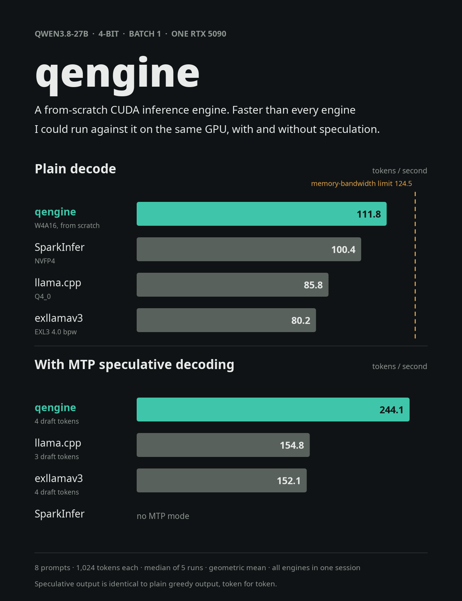

# qengine

**A from-scratch CUDA inference engine that runs Qwen3.8-27B faster than llama.cpp, exllamav3 and
SparkInfer on a single RTX 5090.**

<p align="center"></p>

qengine is built for one model on one GPU: `Qwen/Qwen3.8-27B` (a hybrid of Gated DeltaNet and
gated attention layers, with a built-in MTP draft head) at 4-bit weights, decoding one request at a
time on an RTX 5090. Every kernel, the decode loop, the quantizer and the speculative decoder are
written for this repo.

## Results

Same GPU, same 8 prompts, same session. Every number is the median of 5 runs of 1,024 generated
tokens with greedy decoding and the model's chat template; the table shows the geometric mean over
the 8 prompts.

| Engine | Weights | Plain decode, tok/s | With MTP speculation, tok/s |
|---|---|---:|---:|
| **qengine** | 4-bit, group 128 | **111.8** | **244.1** (4 draft tokens) |
| SparkInfer `f86e43c` | NVFP4 | 100.4 | no MTP mode |
| llama.cpp `1052f7e` | Q4_0 | 85.8 | 154.8 (3 draft tokens) |
| exllamav3 `cdc785d` | EXL3 4.0 bpw | 80.2 | 152.1 (4 draft tokens) |

- qengine is fastest on **every one of the 8 prompts** in both modes: +10.6% to +14.8% plain over
  SparkInfer, and +42.5% to +60.2% with MTP over the best baseline.
- Plain decode runs at **89.8% of the card's memory-bandwidth limit** (124.5 tok/s, from a measured
  1,692 GB/s; see [Why speed is a byte count](#why-speed-is-a-byte-count)).
- Speculative output is **identical to plain greedy output, token for token**, on every prompt and
  draft depth.
- Quality: 4-bit wikitext-2 perplexity is **+2.21%** against the BF16 model (7.2074 vs 7.0517 over
  296,815 tokens).
- vLLM 0.32.0, measured on one prompt: 88.6 tok/s plain, 134.1 with MTP.

<details>
<summary>Per-prompt results (tok/s, median of 5)</summary>

| Engine · mode | prose | code | explain | code 2 | math | chat | summary | json | geomean |
|---|---:|---:|---:|---:|---:|---:|---:|---:|---:|
| **qengine · plain** | 111.9 | 111.9 | 112.0 | 111.9 | 111.9 | 111.9 | 111.6 | 111.6 | **111.8** |
| SparkInfer · plain | 97.5 | 101.1 | 100.8 | 100.9 | 100.9 | 100.9 | 100.7 | 100.7 | 100.4 |
| llama.cpp · plain | 83.9 | 83.8 | 86.9 | 86.3 | 86.4 | 86.5 | 86.3 | 86.6 | 85.8 |
| exllamav3 · plain | 78.6 | 78.7 | 81.0 | 80.7 | 80.8 | 80.8 | 80.7 | 80.7 | 80.2 |
| **qengine · MTP k=4** | 220.8 | 259.9 | 220.7 | 241.8 | 273.1 | 215.0 | 269.6 | 259.9 | **244.1** |
| llama.cpp · MTP n-max 3 | 139.7 | 154.0 | 137.6 | 148.2 | 177.1 | 138.0 | 175.1 | 175.3 | 154.8 |
| exllamav3 · MTP 4 | 148.4 | 166.0 | 130.2 | 150.4 | 162.8 | 126.2 | 166.4 | 174.0 | 152.1 |

</details>

## Quick start

**Requirements:** an RTX 5090 (sm_120), Linux, CUDA 13.x (`nvcc`), Python 3.12, about 70 GB of
disk for the BF16 weights plus an 18 GB quantized cache.

```bash
git clone https://github.com/manaspros/qengine && cd qengine
python3.12 -m venv .venv && source .venv/bin/activate
pip install torch==2.14.1 --index-url https://download.pytorch.org/whl/cu130
pip install -r requirements.txt

# Model weights (BF16, ~55 GB) into ~/models
hf download Qwen/Qwen3.8-27B --local-dir ~/models/Qwen3.8-27B

# Build the CUDA extensions (set CUDA_HOME if CUDA is not in /opt/cuda)
scripts/build.sh

# Decode benchmark: plain and MTP with 4 draft tokens
python bench/engine/bench_decode.py --model ~/models/Qwen3.8-27B --w4 \
    --prompt bench/prompts/prose.txt --spec 4
```

The first run quantizes the model layer by layer and writes the 4-bit cache to
`~/models/qengine-cache/`; later runs load it in seconds.

**Output layer.** The default (`--lm-head w4gptq`) uses a GPTQ-quantized output layer, which keeps
perplexity within +3% of BF16. Build it once:

```bash
python bench/quality/ppl.py fetch                                      # wikitext-2 (needs pyarrow)
python bench/quality/ppl.py run --split train --weights w4rtn --max-windows 32
python bench/quality/ppl.py gptq_head --weights w4rtn --max-windows 32  # writes ~/models/ppl-cache/lm_head_w4gptq.pt
```

Without it, run with `--lm-head same` (plain 4-bit, same speed, +3.07% perplexity) or
`--lm-head bf16` (slower).

**Tests** (212, including checks of single 27B layers against Hugging Face transformers):

```bash
python -m pytest -q tests/
```

`scripts/gpu_lock.sh <cmd>` wraps any command in an exclusive GPU lock so two jobs never share the
GPU during benchmarks.

## Why speed is a byte count

Generating one token for one user multiplies a single vector by every weight matrix in the model.
Each weight is used once per token, so the GPU's time goes to loading weights from memory; the
arithmetic needs about 6 TFLOP/s against more than 200 available.

```
1,692 GB/s (measured read bandwidth) ÷ 13.59 GB read per token = 124.5 tok/s upper limit
```

| Read per token | GB |
|---|---:|
| Decoder weights, 24.35 B at 4.125 bits | 12.557 |
| Output layer, 1.27 B at 4.125 bits | 0.656 |
| DeltaNet recurrent state, read + write, 48 layers | 0.302 |
| KV cache at 1,024 tokens, norms, embedding row | 0.074 |
| **Total** | **13.59** |

So there are two ways to go faster: read fewer bytes per token, or read them closer to full
bandwidth. qengine does both. Its 4-bit format reads 13.59 GB per token (SparkInfer's NVFP4 reads
14.45 GB), and its matrix kernels run at 94.9% of memory bandwidth inside the real decode loop.

One plain decode step takes 8.96 ms: 7.81 ms is the ideal time to stream the weights, 0.42 ms is
matrix-kernel inefficiency, and 0.73 ms goes to the small kernels between them (DeltaNet,
attention, norms).

## How it works

| Technique | What it does | Measured effect |
|---|---|---|
| 4-bit matrix-vector kernel | int4 weights with one fp16 scale per 128 values, packed so each thread issues one 16-byte load that feeds four tensor-core instructions; gate and up projections interleaved so SwiGLU runs in registers; partial sums added in a fixed order, so results are bit-identical every run | 96% of bandwidth on the linear layers |
| One CUDA graph per step | a decode step, or a whole speculative cycle (draft, verify, accept, commit), is one graph replay; positions and tokens stay on the GPU | 2 µs between cycles |
| Programmatic dependent launch | each kernel starts loading while the previous one finishes | plain +5% |
| Exact MTP speculation | the model's MTP head drafts k tokens; one pass verifies k+1 rows at 1.08× the cost of one token; every kernel gives identical results for row r whether it processes 1 row or 8 | 2.18× plain, output identical to plain greedy |
| Lazy DeltaNet rollback | the verify pass writes no recurrent state; the next pass replays only the accepted rows, so rejected drafts cost nothing to undo | no state copies |
| 48K-token draft vocabulary | drafts score 48K likely tokens instead of all 248K; verify still uses the full vocabulary | MTP +4% to +6% |
| DeltaNet kernel ahead of its wait | loads and replays its state before its launch dependency resolves; verify rows run in parallel phases | plain +1.6%, MTP +2.7% |
| Draft weights pinned in L2 | a persisting L2 window keeps the 54 MB of MTP attention weights on chip during drafting | draft phase −7% |

## How it was built

1. **Measure the competition first.** llama.cpp, exllamav3, vLLM and SparkInfer were installed and
   tuned on this exact card, and public claims were reproduced before being treated as targets.
2. **Write a reference.** A pure-PyTorch implementation of the model's math, checked against
   Hugging Face transformers (99.95% top-1 agreement over 2,048 positions), became the oracle for
   every kernel test.
3. **Small model first.** The full CUDA engine ran on Qwen3.5-0.8B in BF16 until its greedy output
   matched Hugging Face for all 1,024 tokens.
4. **Then the 27B at 4 bits,** with a perplexity check against BF16 before any speed work.
5. **Profile, change one thing, measure, keep or revert.** Every optimization was an interleaved
   A/B (median of 5) and had to pass all correctness tests, including speculative output equal to
   plain output.
6. **Final head-to-head** with every engine on 8 prompts in one session.

The work was done with Claude Code agents running in parallel (baselines, research, engine,
kernels, quality), each in its own git worktree, sharing the GPU through an exclusive lock.

## Learnings

- **At batch 1, the job is moving bytes.** The fastest engine is the one that reads the fewest
  bytes per token at the highest bandwidth. Compute barely matters.
- **Measure your own ceiling.** The spec-sheet bandwidth is not what you get; our 1,692 GB/s came
  from a read benchmark, and a kernel that seemed to beat it was really getting 5% of its data from
  L2 because the benchmark reused buffers.
- **Determinism is a feature.** The first matrix kernel used float atomics. One run in fifty
  differed by one rounding step, which flipped a near-tie between two tokens. A fixed summation
  order fixed it and ended up faster.
- **Speculative speed depends on the text, not just the engine.** Changing summation order in one
  kernel changed the generated prose and moved its MTP speed by 8%. Single-prompt MTP numbers are
  not reliable; use many prompts.
- **Benchmark like the user runs it.** Skipping the chat template made outputs degenerate into
  repetition, which looks fast and is wrong. A widely shared "182 tok/s" llama.cpp claim held on
  code prompts and dropped to 110 on prose.
- **Per-kernel wins can be zero-sum.** With overlapped launches, speeding up one kernel can slow the
  next one down, because both compete for the same memory bandwidth. Judge changes by full-step
  time.
- **Most ideas lose.** These were all measured and reverted:

| Experiment | Result |
|---|---|
| Draft trees (several candidates per position) | branches add only 0.1–0.2 tokens per cycle |
| Adaptive draft depth | 231.6 vs fixed depth 236.5 tok/s |
| Prompt-lookup + MTP hybrid drafts | no gain on chat answers |
| BF16 MTP head | acceptance +6% at most; extra bytes cost more |
| Self-distilled MTP head | 234.7 vs stock 235.0 |
| RMSNorm folded into the matrix kernel | plain 111.0 → 104.5 |
| L2 prefetch of the next layer's weights | 0 to −0.2% |
| Lossless entropy-coded 4-bit weights | 9.5% fewer bytes, but decoding can't keep up with memory |
| Exact output-layer pruning with norm bounds | prunes nothing |

## How the numbers were measured

- One machine for every engine: RTX 5090, driver 615.78.08, CUDA 13.4, default clocks and the
  575 W power limit.
- Each benchmark held an exclusive GPU lock and started only after the GPU read idle. Each result
  is the median of 5 runs after a warm-up.
- All engines received identical chat-templated prompts; their reported prompt lengths match on
  all 8 prompts. Every configuration gave identical output across its 5 runs.
- Each baseline ran with its best configuration, found by sweeping its settings on this card.

**Caveats.** Each engine uses its own 4-bit format, so bytes per token differ. qengine is timed
inside its decode loop without an HTTP server (for SparkInfer that overhead was about 0.2%).
Baselines on the first two prompts ran about 3% slow early in the session; excluding those
prompts the gaps hold (111.8 vs 100.8 plain, 245.6 vs 157.6 with MTP). Fast prefill was not a
goal: prompts are processed in passes of 8 tokens.

Baseline scripts are in `bench/baselines/`, the head-to-head runner in `bench/h2h/`
(`suite_baselines.sh`, `suite_aggregate.py`) and the qengine suite in `bench/engine/bench_suite.py`.

## Repository layout

```
csrc/            CUDA kernels: W4 GEMV, Gated DeltaNet, gated attention, norms, argmax
python/qengine/  engine.py (decode loop, CUDA graphs, MTP), reference.py (PyTorch reference
                 matching HF transformers), quant.py (4-bit packing), draft_vocab.py
tests/           kernel, engine, speculative and 27B layer tests
bench/           decode benchmarks, 8-prompt suite, baselines, profiling, perplexity, experiments
```

## Acknowledgements

Qwen for the model and its MTP head; llama.cpp, exllamav3, vLLM and SparkInfer, whose code and
published numbers set the bar; flash-linear-attention, Marlin and the Hazy Research megakernel
write-ups for ideas.

## License

Apache-2.0. See [`LICENSE`](LICENSE). Model weights are not included and are subject to Qwen's
license.
