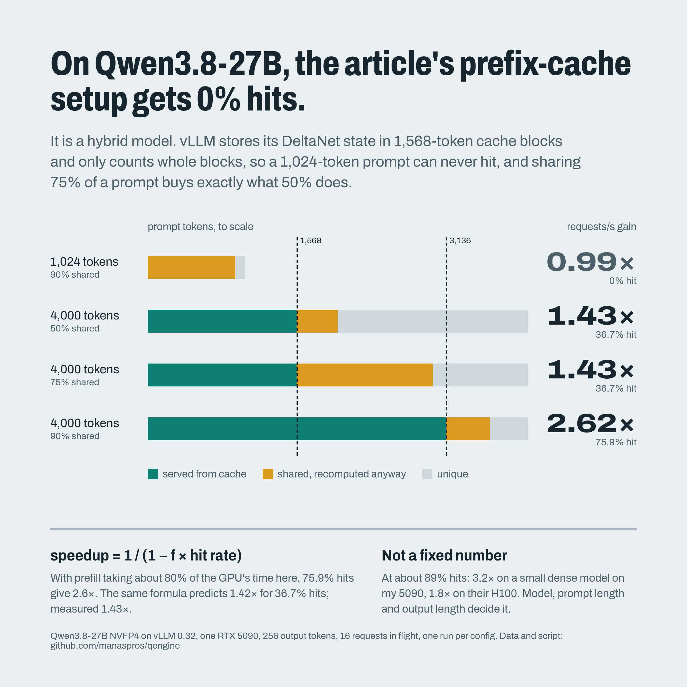

# Prefix caching on one RTX 5090: how much does a cache hit buy?

A side experiment next to the qengine engine: vLLM 0.32.0 on an RTX 5090 (driver 615.78.08), prefix
caching on vs off, on two models. The workload copies
[tokenwatt's H100 measurement](https://www.tokenwatt.io/blog/prefix-cache-revenue-per-gpu-hour.html)
(8 shared prefixes, a fixed share of each prompt shared) so the ratios can be compared.

## Qwen3.8-27B: the cache works in 1,568-token blocks

Qwen3.8-27B is a hybrid: 48 Gated DeltaNet layers and 16 attention layers. A DeltaNet layer keeps
one running state per request (~3.2 MB per layer), not a K/V entry per token. To cache a prefix,
vLLM saves a snapshot of that state at block boundaries (`mamba_cache_mode="align"`, on by default
with prefix caching), and it sizes every cache page to hold one snapshot. Its startup log says:

    Setting attention block size to 1568 tokens to ensure that attention page size is >= mamba page size.

1,568 tokens x 4 KV heads x 256 dims x (K, V) x 1 byte (fp8 KV) ≈ 3.2 MB, the size of one layer's
state. Only whole blocks count as hits.

Gittensor NVFP4 checkpoint, Marlin kernels, 128 requests, 16 in flight, 256 output tokens:

| Prompt | Shared | Cached tokens | Hit rate | Requests/s | vs 0% shared | TTFT p50 |
|---|---:|---:|---:|---:|---:|---:|
| 1,024 tokens, cache off | 90% | 0 | 0% | 2.17 | — | 1,368 ms |
| 1,024 tokens, cache on | 90% | 0 | **0%** | 2.14 | **0.99×** | 771 ms |
| 4,000 tokens | 0% | 0 | 0% | 0.82 | 1.00× | 1,639 ms |
| 4,000 tokens | 50% (2,000) | 1,568 | 36.7% | 1.17 | 1.43× | 1,032 ms |
| 4,000 tokens | 75% (3,000) | 1,568 | 36.7% | 1.17 | **1.43×** | 1,032 ms |
| 4,000 tokens | 90% (3,600) | 3,136 | 75.9% | 2.15 | **2.62×** | 564 ms |
| 4,000 tokens, cache off | 90% | 0 | 0% | 0.83 | — | 2,000 ms |

- The article's shape (1,024-token prompts) never fills a block, so it gets no hits at all.
- Sharing 75% of the prompt buys exactly what 50% does: both cache one block.
- Hit rates sit below cached/prompt (39.2%, 78.4%) because each prefix's first request misses.
- With cache on but 0 hits, p50 time to first token differed from cache off (771 vs 1,368 ms)
  while requests/s was the same. The two runs use different cache layouts; not investigated.

## Qwen2.5-1.5B (dense): same idea, 16-token blocks

Same shape as the article: 1,024 input / 256 output tokens.

### Throughput: 2,048 requests, 256 in flight

| Shared prefix | Cache hit rate | Requests/s | vs 0% | Mean time per output token | p99 time to first token |
|---|---:|---:|---:|---:|---:|
| 0% | 0% | 24.9 | 1.00× | 37.8 ms | 5,632 ms |
| 50% | 49.8% | 44.6 | 1.79× | 21.1 ms | 2,731 ms |
| 75% | 74.7% | 62.3 | 2.51× | 15.1 ms | 1,437 ms |
| 90% | 88.7% | 79.2 | **3.19×** | 11.9 ms | 770 ms |
| 90%, cache off | 0% | 25.5 | — | 36.8 ms | 5,510 ms |
| 90%, 16-token outputs | off → on | 59.4 → 319.8 | **5.4×** | — | 3,833 → 693 ms |

### Latency: one request at a time, 1,000-token shared prefix

| Output | First token, off → on | Whole request, off → on |
|---|---|---|
| 16 tokens | 21.1 → 8.2 ms (2.6×) | 67.4 → 54.5 ms (1.24×) |
| 512 tokens | 21.7 → 8.8 ms (2.5×) | 1,619 → 1,609 ms (1.006×) |

## Why the gain varies

A cache hit skips prefill and nothing else: every output token still needs its own decode step.
So the speedup follows Amdahl's law, with *f* = the share of GPU time spent on prefill:

    speedup = 1 / (1 − f × hit rate)

- Qwen3.8-27B, 4,000-token prompts: 2.62× at 75.9% gives *f* ≈ 0.81. That predicts
  1 / (1 − 0.81 × 0.367) = 1.42× for the one-block case; measured 1.43×.
- Qwen2.5-1.5B: 3.19× at an 88.7% hit rate gives *f* ≈ 0.77. At 256 requests in flight this small dense model is
  compute-bound in both phases, so time roughly follows token count, and 1,024 of every
  1,280 tokens are prompt.
- The H100 measurement got +82% (1.82×) at a similar hit rate, which gives *f* ≈ 0.5: in that setup
  (Qwen3-30B-A3B, a mixture-of-experts model) generating output tokens takes a larger share of the time.
- Short outputs raise *f* (5.4× with 16 output tokens). Long outputs at one user lower it to almost
  nothing (1.006×). Time to first token improves either way, because it is mostly prefill.
- Hit rates sit a little below the shared share (88.7% for 90%) because vLLM caches only full
  16-token blocks, and each prefix's first request misses.

## Method and limits

- `run.py` starts a fresh `vllm serve` for each config, so the cache starts empty. It warms the
  server up with a different random seed, so the warm-up does not fill the cache with the measured
  prefixes. It then runs `vllm bench serve --dataset-name prefix_repetition --ignore-eos` and reads
  the hit rate from the `vllm:prefix_cache_hits_total` and `vllm:prefix_cache_queries_total`
  counters on `/metrics`.
- **One run per config.** Treat differences under ~5% as noise.
- These are **saturation throughput** numbers, not a capacity search under a latency target like
  tokenwatt's. The cache-off runs here would miss a 2 s p99 first-token target.
- Synthetic random-token prefixes (a best case for hit rate), one GPU. The 27B runs use 128 requests each.

Reproduce (needs vLLM 0.32.0; the model downloads from Hugging Face):

    python run.py e1   # 1.5B latency
    python run.py e2   # 1.5B throughput sweep
    # 27B: point VLLM/MODEL at your vLLM and the NVFP4 checkpoint, then
    SERVE="--max-model-len 8192 --max-num-seqs 64 --gpu-memory-utilization 0.88 --language-model-only --generation-config vllm --linear-backend marlin" \
      MODEL=gittensor-model-hub/Qwen3.8-27B-NVFP4-RTX5090 OUT=results27b python run.py e3a   # then e3b

`results.txt` is the summary; `results/` (1.5B) and `results27b/` hold the raw `vllm bench serve` JSON.
